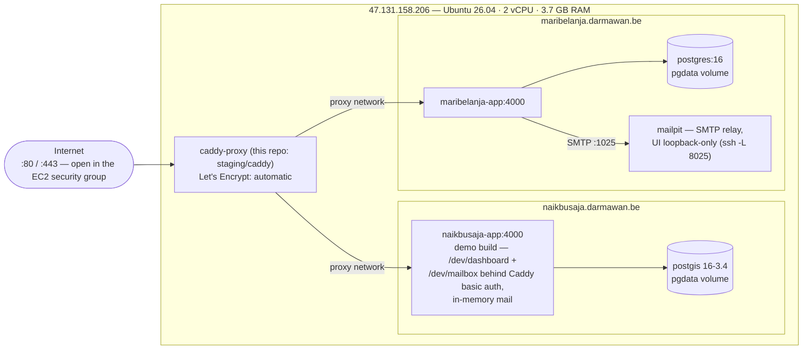

# darmawan.be staging

One small EC2 instance hosting both apps behind a single Caddy reverse proxy.
Config lives in this repo; the Mac is the control plane and `rsync` over SSH
is the deploy mechanism — nothing is cloned from GitHub on the box.



*The shared external docker network `proxy` is the only bridge between the
stacks — both `caddy-proxy → app` edges cross it.*

## Server layout

| Path | What |
| --- | --- |
| `/opt/caddy/` | Caddyfile + compose (rsynced from `staging/caddy/`); `.dev-bcrypt` + `dev-auth-credentials.txt` are generated locally there and never synced |
| `/opt/naikbusaja/` | naikbusaja source + `docker-compose.staging.yml` + `.env` |
| `/opt/maribelanja/` | maribelanja source + `docker-compose.staging.yml` + `.env` |

Secrets are generated on the server by `make secrets` (`.env`, chmod 600) and
never stored in this repo — only `.env.example` templates live here.

## First bring-up

```bash
make check        # SSH works, docker absent, ports 80/443 REFUSED (SG open)
make bootstrap    # install docker, /opt dirs, `docker network create proxy`
make secrets      # .env files + caddy basic auth (prints the /dev password once)
make caddy        # proxy up; Let's Encrypt certs issued automatically
make deploy       # naikbusaja, then maribelanja (one Elixir build at a time)
```

DNS must point both hostnames at the instance before `make caddy` (it already
does: `naikbusaja.darmawan.be` and `maribelanja.darmawan.be` → 47.131.158.206).

## Deploying code updates

The whole loop is: **edit code locally → `make <app>`**. Nothing else — the
make target rsyncs the changed source to `/opt/<app>/`, rebuilds the image
(only changed Docker layers), and recreates the containers.

```bash
# naikbusaja — source lives at ~/projects/naikbusaja
cd ~/projects/darmawan.be/staging && make naikbusaja

# maribelanja — source lives at ~/projects/elixir/github.com/jeffdarmawan/maribelanja
make maribelanja

# both, sequentially (one Elixir build at a time)
make deploy
```

What each deploy does, in order:

1. `rsync` the app source → `/opt/<app>/` (incremental; `_build/`, `deps/`,
   `node_modules/`, `.git/` are excluded, and the server's `.env` +
   `docker-compose.staging.yml` are protected from deletion).
2. `docker compose -f docker-compose.staging.yml up -d --build` on the server —
   image build (~1–5 min incremental), then containers are recreated.
3. **Migrations run automatically** — naikbusaja in its entrypoint on boot,
   maribelanja via the one-shot `migrate` service before the app starts.

Watching a deploy:

```bash
make logs-naikbusaja     # first boot migrates + imports feeds (only if empty)
make logs-maribelanja    # migrate → app → mailpit startup
curl -fsS https://maribelanja.darmawan.be/health        # "ok" after deploy
```

Rollback: `git -C <app-repo> checkout <previous-sha>` then `make <app>` —
code rolls back cleanly; migrations don't (write them to be reversible).

Caveats:

- naikbusaja's demo flags (`DEV_ROUTES_COMPILE`, `MAIL_LOCAL_COMPILE`) are
  **compile-time** — changing them in `docker-compose.staging.yml` needs the
  rebuild that `make naikbusaja` already does.
- If a build dies on the tailwind CLI download (GitHub CDN flake), the
  vendored binary in `naikbusaja/vendor/` covers it (see Gotchas).
- Config-only changes (Caddyfile, staging compose) don't need an app build:
  `make caddy` re-syncs the Caddyfile; app compose changes ride along with
  the next `make <app>` (they are copied on every deploy).

## Smoke tests

```bash
curl -sI http://naikbusaja.darmawan.be | head -3        # 308 → https
curl -fsS https://naikbusaja.darmawan.be -o /dev/null -w '%{http_code}\n'  # 200
curl -fsS https://maribelanja.darmawan.be/health        # "ok"
curl -fsS https://maribelanja.darmawan.be/users/log-in -o /dev/null -w '%{http_code}\n'  # 200
```

- **naikbusaja login flow**: request a magic link on the site, then open
  `https://naikbusaja.darmawan.be/dev/mailbox` (basic auth — password printed
  by `make secrets`, also in `/opt/caddy/dev-auth-credentials.txt` on the server).
- **maribelanja mail**: `ssh -L 8025:127.0.0.1:8025 ubuntu@47.131.158.206`
  → http://localhost:8025 (Mailpit; loopback-only by design).
- **LiveView sanity**: load a page, interact — if forms do nothing, check
  `make logs-*` for `check_origin` errors (PHX_HOST must equal the browsed hostname).

## Gotchas

- **PHX_HOST must match the browsed hostname exactly** — Phoenix's
  `check_origin` silently kills LiveView WebSockets otherwise.
- **Builds one at a time.** The box has 2 vCPU / 3.7 GB; two concurrent Elixir
  builds will OOM. `make deploy` is sequential on purpose.
- **The `/dev/*` routes are public** (behind basic auth) — that is what makes
  magic-link logins work without SMTP on naikbusaja. The demo build flags
  (`DEV_ROUTES_COMPILE`, `MAIL_LOCAL_COMPILE`) are compile-time; changing them
  means a rebuild.
- **DB passwords**: naikbusaja keeps the upstream compose defaults (postgres/
  postgres, no published port, internal network only); maribelanja's is
  generated hex in `/opt/maribelanja/.env`.
- **Mailpit UI is never public** — SSH tunnel only.
- **Docker bypasses ufw** for published ports; nothing publishes ports except
  Caddy (80/443) and Mailpit (loopback-bound).
- **Tailwind vendoring (naikbusaja).** `mix assets.deploy` downloads the
  tailwind CLI from GitHub's release CDN, which 504'd during this setup. The
  naikbusaja Dockerfile now vendors an optional binary from `vendor/`
  (`tailwind-linux-x64-4.3.3`, recovered from the first successful build's
  Docker cache) so rebuilds don't depend on that CDN. If the configured
  tailwind version changes, refresh `vendor/` (or empty it once GitHub is
  reachable again).

## Uncommitted changes in the app repos (from this setup)

- `naikbusaja/config/runtime.exs` — generated mail URLs included the
  *listener* port (`:4000`), which Caddy doesn't serve. URLs now use 443 for
  https (plain-http demo compose keeps its `:4000` URLs).
- `naikbusaja/Dockerfile` + `naikbusaja/vendor/` — optional tailwind CLI
  vendoring (see gotcha above).

Review and commit these in the naikbusaja repo as you see fit; staging
rebuilds depend on them staying.

## Teardown / rebuild

```bash
make ssh
cd /opt/<stack> && docker compose down [-v]   # -v wipes the pgdata volume
```
